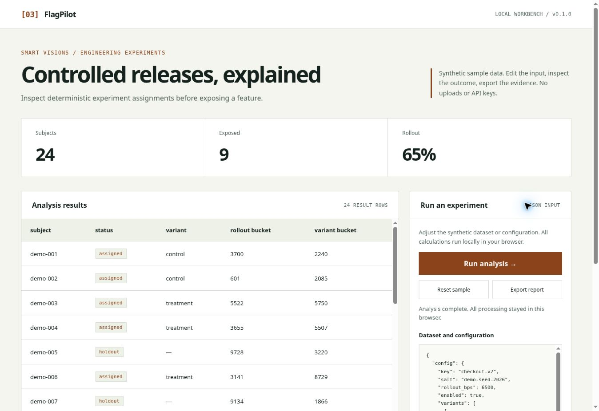

# FlagPilot

**Inspect deterministic experiment assignments before exposing a feature.**

A dependency-free JavaScript engineering workbench by Hamed Minaei.
The browser demo and Node CLI use the **same tested engine source**. No model
API, account, build service or runtime dependency is required.

**[Open live demo](https://hamed665.github.io/release-rollout-workbench/)**



## Try the browser demo

Download the repository and open **[docs/index.html](docs/index.html)** in a modern
browser. It is a self-contained generated file, so it works offline with a
`file://` URL. The example dataset is synthetic. Edit the JSON, run the analysis,
inspect the result table and export the full report. Invalid input clears stale
results and disables export until a new analysis succeeds.

To host the demo, serve `docs/` with any static host. The public demo is also deployed with GitHub Pages.

## Run locally

Requires Node.js 22 or newer; no `npm install` step is needed.

```bash
git clone https://github.com/hamed665/release-rollout-workbench.git
cd release-rollout-workbench
npm test
npm run demo
npm run build
node scripts/demo.mjs examples/input.json
```

## Library interface

```javascript
import { analyze } from './src/core.mjs';
import { readFile } from 'node:fs/promises';
const input = JSON.parse(await readFile('examples/input.json', 'utf8'));
const report = analyze(input);
console.log(report.summary, report.rows);
```

See [src/core.mjs](src/core.mjs) for lower-level functions and
[tests/core.test.mjs](tests/core.test.mjs) for behavioral examples.

## What this demonstrates

Controlled releases, explained. The implementation is written for inspection: explicit validation,
deterministic behavior, structured reports, realistic failure paths and a
usable responsive demo. All result data is rendered as text, never as HTML.
The UI includes keyboard-operable controls, labeled input, a live error/status
region, an empty state and a horizontally scrollable results table.

## Engineering boundaries

FNV-1a is a deterministic noncryptographic hash; never use this for authorization, eligibility decisions, fraud controls or secret allocation. There is no remote configuration server or experiment significance analysis. Changing salt, key or variant weights may reassign subjects. Use pseudonymous IDs.

This is a reference implementation, not a hosted production system. There are
no customer datasets, claimed client deployments or fabricated performance
metrics. Security considerations are documented in [SECURITY.md](SECURITY.md).

## Architecture

- `src/core.mjs`: domain engine, usable independently of the UI
- `src/validation.mjs`: explicit shared input contracts
- `web/`: accessible presentation and interaction source
- `scripts/build.mjs`: deterministic offline HTML generation
- `scripts/demo.mjs`: JSON-in / JSON-out CLI
- `docs/index.html`: ready-to-open generated browser demo
- `examples/`: synthetic input and captured output
- `tests/`: invariants, boundaries and regression tests

Run `npm run build` after editing engine, UI or input fixtures. CI checks that
the committed demo matches its sources on Node 22 and 24.

## License

MIT — [LICENSE](LICENSE). See [CONTRIBUTING.md](CONTRIBUTING.md).
